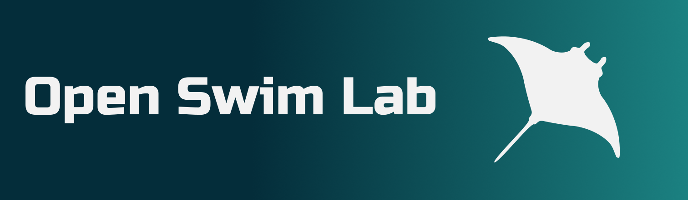

 

  

 

>[!WARNING]
>**Early development — Alpha**
>
>This project is in an early stage of development.
>The application is not yet functional and is not ready for general use.

# Features

# Use

# Contributing

# Development
See the [Project Roadmap](https://tree.taiga.io/project/nerisal-open-swim-lab/kanban) to follow the project's development progress and planned features.

# License
This project is licensed under the AGPL-3.0 License - see the LICENSE file for details.

  <i>Made with 🍅 from 🇮🇹</i>

